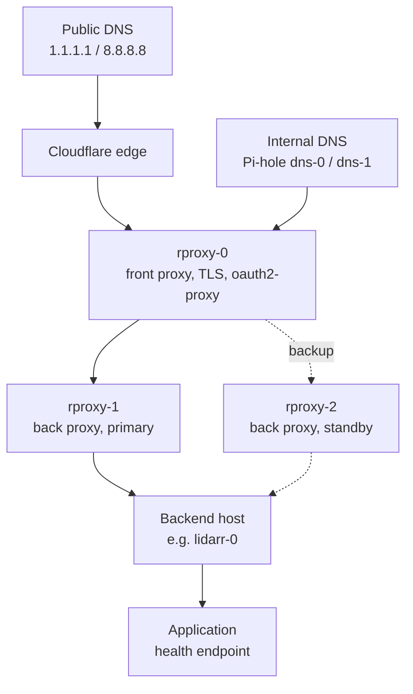
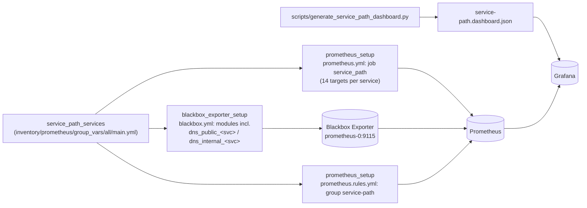

# Service Path Dashboard

The **Service Path** dashboard (`/d/service-path`) answers one question during an outage:

> *The service is unavailable. At which point in the request path does connectivity stop?*

Instead of a single up/down check against `https://<service>.refol.us`, every hop of the request path is
probed independently: public DNS, internal DNS, the Cloudflare edge, the front proxy, both back proxies,
the backend host and the application itself. Prometheus recording rules turn those probe results into a
health value per component and per hop, and into a **probable failure location**. The dashboard draws the
result as an animated topology.

This guide explains how the dashboard is built, from the inventory list down to the Grafana panels. It also
covers how to add a service and how to troubleshoot the dashboard itself.

- [Request path being modelled](#request-path-being-modelled)
- [How the pieces fit together](#how-the-pieces-fit-together)
- [Step 1: Define the service](#step-1-define-the-service)
- [Step 2: Blackbox Exporter modules](#step-2-blackbox-exporter-modules)
- [Step 3: Prometheus scrape targets](#step-3-prometheus-scrape-targets)
  - [Labels](#labels)
  - [Cloudflare edge IP](#cloudflare-edge-ip)
  - [Target preservation](#target-preservation)
- [Step 4: Recording rules](#step-4-recording-rules)
  - [Value encoding](#value-encoding)
  - [Component rules: `service_path:node_health{node=...}`](#component-rules-service_pathnode_healthnode)
  - [Hop rules: `service_path:edge_health{edge=...}`](#hop-rules-service_pathedge_healthedge)
  - [Traffic rules: `service_path:edge_flow{edge=...}`](#traffic-rules-service_pathedge_flowedge)
  - [Path rules: `service_path:path_health{path=...}`](#path-rules-service_pathpath_healthpath)
  - [Probable failure location: `service_path:probable_failure_code`](#probable-failure-location-service_pathprobable_failure_code)
- [Step 5: The Grafana dashboard](#step-5-the-grafana-dashboard)
  - [Source and generation](#source-and-generation)
  - [Variables](#variables)
  - [Sections and queries](#sections-and-queries)
- [Deploying](#deploying)
- [Adding a new service](#adding-a-new-service)
  - [Testing a probe by hand](#testing-a-probe-by-hand)
- [Verification and troubleshooting](#verification-and-troubleshooting)
- [Known limitations](#known-limitations)
- [File reference](#file-reference)

---

## Request path being modelled



Facts about this environment that shaped the design:

| Fact | Where it comes from | Consequence |
|---|---|---|
| Public names are proxied by Cloudflare (`172.67.x`, `104.21.x`). | Public DNS, `NS` = `*.ns.cloudflare.com` | The external path really starts at Cloudflare. |
| Internally, Pi-hole answers `CNAME <service> -> rproxy-0.refol.us` (split DNS). | `pihole_cname_entries` in each inventory | Probing `https://lidarr.refol.us` from inside the LAN never reaches Cloudflare, so the external probe must target a Cloudflare IP directly. |
| rproxy-0 terminates TLS on 443 and forwards to an upstream of `rproxy-1` (primary, `max_fails=3`) and `rproxy-2` (`backup`). | `rproxy_setup_backend_servers` in `roles/rproxy_setup/defaults/main.yml` | Back proxies are **active/standby**, not load balanced. rproxy-2 carries traffic only when rproxy-1 is down. |
| rproxy-1/2 listen on port 80 and select the site by `server_name`. | `roles/rproxy_setup/templates/site.conf.j2` | A proxy must be tested **with the service's Host header**. Requesting the bare IP hits a different server block. |
| An unknown Host on any proxy returns `301 -> /projects/home-lab` (the catch-all server block). | Observed on rproxy-0/1/2 | A redirect to `/projects/home-lab` means "vhost missing", not "app redirected to its login". |
| Sites with `use_oauth2: true` gate `location /` with `auth_request` on rproxy-0. Unauthenticated requests get the oauth2-proxy sign-in page with **403**. | `roles/oauth2_proxy_setup/tasks/add_oauth2_directives_to_nginx_config.yml` | Probes through rproxy-0 cannot reach the backend of an oauth2 site. They prove the edge, TLS, vhost and oauth2-proxy only, so the backend is tested separately. |

---

## How the pieces fit together



One list in the inventory drives everything. Nothing in the roles or the dashboard names a specific service.
The dashboard discovers services through its `$service` variable.

---

## Step 1: Define the service

Services are listed in `service_path_services` in `inventory/prometheus/group_vars/all/main.yml`. Both roles
read it through their own role-prefixed variable:

- `blackbox_exporter_setup_service_path_services: "{{ service_path_services | default([]) }}"`
- `prometheus_setup_service_path_services: "{{ service_path_services | default([]) }}"`

```yaml
service_path_services:
  - service: lidarr              # value of the `service` label and of the dashboard's $service variable
    fqdn: lidarr.refol.us        # DNS query name, Host header and TLS SNI
    backend_host: lidarr-0       # inventory hostname; the IP comes from global_ip_addresses
    backend_port: 8686           # application port on the backend host
    health_path: /ping           # unauthenticated health endpoint (also requested through rproxy-1/2)
    frontdoor_auth: oauth2       # oauth2 | none (does rproxy-0 gate the site with oauth2-proxy?)
```

| Field | Required | Default | Purpose |
|---|---|---|---|
| `service` | yes | | Label value and dashboard variable value. Must be unique. Also used in generated module names (`dns_public_<service>`). |
| `fqdn` | yes | | Public/internal virtual host name. |
| `backend_host` | yes | | Inventory hostname of the application VM. Must exist in `global_ip_addresses`. |
| `backend_port` | yes | | Application port. |
| `health_path` | no | `/` | Path requested on the app directly and through each back proxy. May include a query string, e.g. `/api?mode=version`. |
| `frontdoor_auth` | no | `oauth2` | Selects the `https_frontdoor_*` and `https_edge_*` module variant. Must match the site's `use_oauth2` in `rproxy_setup_sites`. |
| `health_accept_redirects` | no | `false` | `true` selects the lenient `http_vhost_reachable` module: a 3xx, 401 or 403 from the app counts as healthy. Use it when the health path redirects to a login page or has not been verified. |
| `internal_dns_expected_ip` | no | front proxy IP | Address the internal resolvers must return. Set `""` for names without split DNS (e.g. `demo.ecube.one`), where only a non-empty answer is required. |
| `edge_ip` | no | resolved at deploy time | Pins the Cloudflare edge IP used by the external probe instead of looking it up. |

Shared settings live in `roles/prometheus_setup/defaults/main/main.yml`:

| Variable | Default | Meaning |
|---|---|---|
| `prometheus_setup_service_path_job_name` | `service_path` | Prometheus job name used by every probe, rule and dashboard query. |
| `prometheus_setup_service_path_scrape_interval` | `30s` | Probe interval; also the rule group evaluation interval. |
| `prometheus_setup_service_path_scrape_timeout` | `15s` | Must exceed the slowest module timeout (10 s for edge probes). |
| `prometheus_setup_service_path_slow_seconds` | `2` | `probe_duration_seconds` above this marks a hop *degraded*. |
| `prometheus_setup_service_path_public_resolvers` | `[1.1.1.1, 8.8.8.8]` | Targets of the public DNS probes. |
| `prometheus_setup_service_path_doh_url` | `https://cloudflare-dns.com/dns-query` | DNS-over-HTTPS endpoint used to find the Cloudflare edge IP. |
| `prometheus_setup_service_path_internal_dns_hosts` | `[dns-0, dns-1]` | Internal resolvers, by inventory hostname. |
| `prometheus_setup_service_path_front_proxy` | first host of `rproxy_main` | Front proxy (rproxy-0). |
| `prometheus_setup_service_path_back_proxy_primary` | first host of `rproxy_primary` | Primary back proxy (rproxy-1). |
| `prometheus_setup_service_path_back_proxy_standby` | first host of `rproxy_secondary` | Standby back proxy (rproxy-2). |
| `prometheus_setup_service_path_front_proxy_port` | `443` | TCP port probed on the front proxy. |
| `prometheus_setup_service_path_back_proxy_port` | `80` | Port probed on the back proxies. |
| `prometheus_setup_service_path_rules_enabled` | `true` | Renders the `service-path` rule group. |

---

## Step 2: Blackbox Exporter modules

The `blackbox_exporter_setup` role renders `/etc/blackbox_exporter/blackbox.yml` on `prometheus-0`. The
service path adds these modules to `blackbox_exporter_setup_modules` in
`roles/blackbox_exporter_setup/defaults/main.yml`:

| Module | Prober | Used for | Success means |
|---|---|---|---|
| `icmp_ipv4` | icmp | Backend host | The host answers ping. |
| `tcp_connect_ipv4` | tcp | Front proxy :443, back proxies :80, app port | The port accepts a TCP connection. |
| `http_vhost_2xx` | http | App health path, directly and through each back proxy | 2xx; redirects are **not** followed, so a 301 from the catch-all fails. |
| `http_vhost_reachable` | http | Same, for `health_accept_redirects: true` | 2xx, 3xx, 401 or 403, **unless** `Location` matches `/projects/home-lab` (catch-all). |
| `https_frontdoor_oauth2` | http | rproxy-0, oauth2 sites | TLS, then 401/403 with a body matching `OAuth2_Proxy\|oauth2/static`. |
| `https_frontdoor_open` | http | rproxy-0, open sites | TLS, then 2xx/3xx/401/403/502/503/504. |
| `https_edge_oauth2` | http | Cloudflare edge, oauth2 sites | As frontdoor_oauth2, plus header `Server: cloudflare`. |
| `https_edge_open` | http | Cloudflare edge, open sites | As frontdoor_open, plus header `Server: cloudflare`. |
| `dns_public_<service>` | dns | Public resolvers | `NOERROR`, at least one `A` record, and **no private address** in the answer. |
| `dns_internal_<service>` | dns | Pi-hole resolvers | `NOERROR` and an `A` record equal to `internal_dns_expected_ip` (default: rproxy-0's IP). |

Design notes:

- **Virtual hosting.** The HTTP probes pass the service name as the Blackbox `hostname` URL parameter
  (supported since Blackbox 0.24). It sets the `Host` header and, for HTTPS, the TLS SNI, so
  `https://192.168.30.210/` with `hostname=lidarr.refol.us` tests exactly the Lidarr server block and certificate.
  It is set per target with `__param_hostname`, so the HTTP modules stay generic.
- **The DNS modules are generated per service** in `templates/blackbox.yml.j2`, because the DNS prober
  takes `query_name` from the module, not from the target. The answer regexes are matched against the
  record's text form (`name<TAB>ttl<TAB>IN<TAB>A<TAB>address`) and use `\s` rather than literal tabs.
- **Open sites accept 502–504 at rproxy-0 and the edge.** On sites without oauth2, rproxy-0 passes the
  backend's answer through. Without this, a backend outage would also make rproxy-0 and Cloudflare look broken.
  Cloudflare's *own* origin errors are 520–530 and still fail.
- **ICMP.** The exporter runs as the unprivileged `blackbox-exporter` user. The systemd unit adds
  `AmbientCapabilities=CAP_NET_RAW` so it can open raw ICMP sockets. Nothing has to be installed on the
  probed VMs; the kernel answers echo requests unless a firewall blocks them.
- **Config validation.** The template task runs `blackbox_exporter --config.check` before installing the
  file. Blackbox rejects unknown keys at startup, and without this check a typo stops the exporter and
  every probe that depends on it. With the check, the playbook fails and the running exporter is untouched.

---

## Step 3: Prometheus scrape targets

`roles/prometheus_setup/templates/prometheus.yml.j2` renders one job, `service_path`, with **14 targets per
service**. Each target is one hop and one probe type:

| `instance` | `component` | `probe_type` | `path` | Module | Target |
|---|---|---|---|---|---|
| `<svc>/public_dns/1.1.1.1` | `public_dns` | dns | external | `dns_public_<svc>` | `1.1.1.1` |
| `<svc>/public_dns/8.8.8.8` | `public_dns` | dns | external | `dns_public_<svc>` | `8.8.8.8` |
| `<svc>/internal_dns/dns-0` | `internal_dns` | dns | internal | `dns_internal_<svc>` | dns-0 IP |
| `<svc>/internal_dns/dns-1` | `internal_dns` | dns | internal | `dns_internal_<svc>` | dns-1 IP |
| `<svc>/cloudflare/https` | `cloudflare` | http | external | `https_edge_<auth>` | `https://<edge_ip>/` + hostname |
| `<svc>/rproxy-0/https` | `rproxy-0` | http | internal | `https_frontdoor_<auth>` | `https://<rproxy-0>/` + hostname |
| `<svc>/rproxy-0/tcp` | `rproxy-0` | tcp | internal | `tcp_connect_ipv4` | `<rproxy-0>:443` |
| `<svc>/rproxy-1/http` | `rproxy-1` | http | backend | health module | `http://<rproxy-1>:80<health_path>` + hostname |
| `<svc>/rproxy-1/tcp` | `rproxy-1` | tcp | backend | `tcp_connect_ipv4` | `<rproxy-1>:80` |
| `<svc>/rproxy-2/http` | `rproxy-2` | http | backend | health module | `http://<rproxy-2>:80<health_path>` + hostname |
| `<svc>/rproxy-2/tcp` | `rproxy-2` | tcp | backend | `tcp_connect_ipv4` | `<rproxy-2>:80` |
| `<svc>/host/icmp` | `host` | icmp | backend | `icmp_ipv4` | backend IP |
| `<svc>/app/tcp` | `app` | tcp | backend | `tcp_connect_ipv4` | `<backend>:<port>` |
| `<svc>/app/http` | `app` | http | backend | health module | `http://<backend>:<port><health_path>` |

`<auth>` is `oauth2` or `open` from `frontdoor_auth`. The health module is `http_vhost_2xx`, or
`http_vhost_reachable` when `health_accept_redirects: true`.

### Labels

| Label | Values | Purpose |
|---|---|---|
| `service` | `lidarr`, `sonarr`, … | Selects the service; drives `$service`. |
| `component` | `public_dns`, `internal_dns`, `cloudflare`, `rproxy-0`, `rproxy-1`, `rproxy-2`, `host`, `app` | Which hop the probe tests. Proxy components use the hostname. |
| `probe_type` | `dns`, `http`, `tcp`, `icmp` | Lets rules distinguish "port open" from "HTTP correct". |
| `path` | `external`, `internal`, `backend` | Which request path the probe belongs to. |
| `role` | `front_proxy`, `back_proxy_primary`, `back_proxy_standby` | Proxy probes only; stable even if hostnames change. |
| `backend` | e.g. `lidarr-0` | Lets the dashboard join node_exporter `up` for the backend host. |
| `vhost` | e.g. `lidarr.refol.us` | Copied from `__param_hostname` by relabeling; only on probes sent with a Host header. |
| `target` | probe target | Copied from `__param_target`, as in the existing `blackbox_http` job. |

The static labels are set in the template macro `service_path_target`. `__param_module` and
`__param_hostname` become URL parameters on the `/probe` request and are dropped after relabeling.
The relabel rules are the usual Blackbox pattern: `__address__ -> __param_target -> target`, then
`__address__` is replaced with `prometheus_setup_blackbox_exporter_address`.

### Cloudflare edge IP

Inside the LAN the fqdn resolves to rproxy-0, so the external probe needs a Cloudflare address to send
the request to. `roles/prometheus_setup/tasks/service_path.yml` resolves it on every deploy:

1. For each service without `edge_ip`, `ansible.builtin.uri` calls the DoH endpoint
   (`?name=<fqdn>&type=A`, `Accept: application/dns-json`) **from the Prometheus host**.
2. The response body is parsed with `from_json`. The `uri` module does not parse the `application/dns-json`
   content type itself, so the body has to be parsed explicitly. The first `type == 1` (A) answer becomes
   `prometheus_setup_service_path_edge_ips[<service>]`.
3. Services with `edge_ip` are added as pinned.
4. If no address is found, a warning is printed and the Cloudflare probe for that service is **skipped**.
   The dashboard then shows the Cloudflare box gray (not tested).

Re-running the Prometheus playbook refreshes the address if Cloudflare changes it.

### Target preservation

Both `main.yml` (used by `deploy_prometheus.yml`) and `exporters.yml` (used by
`deploy_prometheus_exporters.yml`) render `prometheus.yml` through `exporters.yml`. That file reads the
existing config and keeps targets registered from other inventories (node, nginx, postgres, ceph, pve,
pihole, plex, blackbox), then adds the service-path job. Before this was unified, running
`deploy_prometheus.yml` with `inventory/prometheus` replaced all exporter targets with that inventory's
hosts.

---

## Step 4: Recording rules

`roles/prometheus_setup/templates/prometheus.rules.yml.j2` renders the rule group `service-path`,
evaluated every 30 s. All logic lives here, so the dashboard queries stay simple and the same series can
drive alerts later.

### Value encoding

| Value | Meaning | Dashboard colour |
|---|---|---|
| `2` | Healthy | green |
| `1` | Degraded: slow (`probe_duration_seconds > slow_seconds`), partial (one of several resolvers), or answering but not correctly | yellow |
| `0` | Failed | red |
| *no series* | Not evaluated: no probe data, or the hop cannot be tested because an earlier hop failed | gray |

Every rule aggregates `by (service)`, so one rule covers all services. Within a rule, conditions are chained
with PromQL `or`, so the first matching branch wins for each service.

### Component rules: `service_path:node_health{node=...}`

| `node` | 2 (OK) | 1 (degraded) | 0 (failed) |
|---|---|---|---|
| `public_dns` | All public resolvers succeed and are fast | Some succeed, or slow | None succeed |
| `internal_dns` | Both Pi-holes answer with the expected IP, fast | One does, or slow | Neither |
| `cloudflare` | Edge probe succeeds, fast; **or** Cloudflare answers 520–530 (edge up, origin unreachable) | Slow, or any other HTTP answer (e.g. a WAF block) | No HTTP answer |
| `front_proxy` | HTTPS front-door probe succeeds, fast | Slow, or TCP 443 open but the HTTPS/vhost/oauth2 check fails | TCP 443 closed |
| `back_proxy_primary` / `back_proxy_standby` | Vhost probe succeeds, **or** the proxy answers 502–504 (nginx is fine, its upstream is not) | TCP open but any other answer (e.g. vhost missing) | TCP port closed |
| `host` | Ping answers **or** the app port accepts TCP | | Neither |
| `app` | Health endpoint succeeds, fast | Slow | Fails |
| `back_proxy_layer` | Best of (rproxy-1 node & hop, rproxy-2 node & hop): traffic can get through either back proxy | | |

### Hop rules: `service_path:edge_health{edge=...}`

| `edge` | Hop | Source of truth |
|---|---|---|
| `dns_edge` | Public DNS → Cloudflare | Same as `public_dns` |
| `edge_front` | Cloudflare → rproxy-0 | Edge probe succeeds → 2 (slow → 1); Cloudflare 520–530 → **0** (proven broken); otherwise absent |
| `idns_front` | Internal DNS → rproxy-0 | Same as `internal_dns` (the answer is validated to be rproxy-0) |
| `front_bp1` / `front_bp2` | rproxy-0 → rproxy-1 / rproxy-2 | Existing textfile metric `rproxy_backend_reachable{instance="rproxy-0",backend=...}` × 2, measured **on rproxy-0** every 5 minutes |
| `bp1_host` / `bp2_host` | rproxy-1 / rproxy-2 → backend | Vhost probe succeeds → 2; proxy answers 502–504 → **0**; otherwise absent |
| `host_app` | Host → application port | App TCP probe: open → 2, closed → 0 |

### Traffic rules: `service_path:edge_flow{edge=...}`

These say which hops **should be carrying traffic right now**, and they drive the animation:

- `dns_edge`, `edge_front`, `idns_front`, `host_app`: present when the hop is healthy (≥ 1).
- `front_bp1`, `bp1_host`: present when the hop is healthy **and** rproxy-1 is up.
- `front_bp2`, `bp2_host`: present when the hop is healthy **and** rproxy-1 is **down** (nginx failover to
  the `backup` upstream).

### Path rules: `service_path:path_health{path=...}`

- `external`: worst of `public_dns`, `cloudflare`, `edge_front`, `front_proxy`, `back_proxy_layer`, `host`, `app`.
- `internal`: worst of `internal_dns`, `front_proxy`, `back_proxy_layer`, `host`, `app`.

### Probable failure location: `service_path:probable_failure_code`

Conditions are checked in this order; the first match wins:

| Order | Code | Condition | Dashboard text |
|---|---|---|---|
| 1 | 1 | public DNS = 0 **and** internal DNS = 0 | DNS FAILURE |
| 2 | 5 | front proxy = 0 but Cloudflare still reaches it (`edge_front` ≥ 1) | INTERNAL PATH FAILURE: LAN cannot reach rproxy-0 |
| 3 | 6 | front proxy = 0 | FRONT PROXY FAILURE |
| 4 | 13 | `front_bp1` = 0 **and** `front_bp2` = 0 | BACK PROXY LINK FAILURE |
| 5 | 7 | both back proxies = 0 | BACK PROXY FAILURE |
| 6 | 8 | host = 0 | BACKEND HOST UNREACHABLE |
| 7 | 9 | app = 0 | APPLICATION FAILURE |
| 8 | 3 | internal DNS = 0 | INTERNAL PATH FAILURE: internal DNS |
| 9 | 2 | public DNS = 0 | EXTERNAL PATH FAILURE: public DNS |
| 10 | 12 | `edge_front` = 0 (Cloudflare 52x) | EXTERNAL PATH FAILURE: Cloudflare cannot reach origin |
| 11 | 4 | Cloudflare = 0 | EXTERNAL PATH FAILURE: Cloudflare / public edge |
| 12 | 10 | front proxy = 1 | FRONT PROXY DEGRADED |
| 13 | 11 | any node or edge < 2 | DEGRADED |
| 14 | 0 | otherwise | Healthy |

Why this order:

- **Shared components first.** Failures of rproxy-0, the back proxies, the host or the app break **both**
  paths, so they are checked before the path-specific DNS and Cloudflare conditions.
- **rproxy-0 vs the LAN.** When rproxy-0 fails from the LAN but Cloudflare can still reach it, the problem is
  internal routing (e.g. the lan20 → lan30 path), not the proxy.
- **Cloudflare vs origin.** A Cloudflare 52x means Cloudflare is up and cannot reach the origin. This is
  reported separately from Cloudflare being unreachable.

The dashboard always calls the result a **probable** failure location. It is an inference from which
probes fail, not a proven root cause.

---

## Step 5: The Grafana dashboard

### Source and generation

The dashboard JSON is generated, not hand-edited:

```bash
python3 scripts/generate_service_path_dashboard.py          # writes the JSON below
# roles/grafana_setup/files/dashboards/service-path.dashboard.json
```

The script builds the Canvas topology from a small layout description (column centres and row tops, in
percent). Each hop is defined once and expanded into its two connections, which keeps the element names,
field names and value mappings consistent. Edit the script, regenerate, and commit **both** files. The file
is provisioned by `grafana_setup` (`roles/grafana_setup/tasks/dashboards.yml`), uid `service-path`. UI edits
are not saved back (`grafana_setup_dashboard_allow_ui_updates: false`).

### Variables

| Variable | Query | Visible |
|---|---|---|
| `service` | `label_values(probe_success{job="service_path"}, service)` | yes, the service picker |
| `fqdn` | `label_values(probe_success{job="service_path",service="$service",vhost!=""}, vhost)` | hidden |
| `backend` | `label_values(probe_success{job="service_path",service="$service"}, backend)` | hidden |

A new entry in `service_path_services` appears in the picker automatically after deployment.

### Sections and queries

**1. Service overview** (stat panels)

| Panel | Query | Display |
|---|---|---|
| Service | `max by (vhost) (probe_success{job="service_path",service="$service",vhost!=""})` | Series name = fqdn |
| Overall status | `service_path:probable_failure_code{service="$service"}` | 0 HEALTHY, 10–11 DEGRADED, other DOWN, no data UNKNOWN |
| External path / Internal path | `service_path:path_health{service="$service",path="external"\|"internal"}` | OK / DEGRADED / FAILED |
| HTTP status (via back proxy) | `max(probe_http_status_code{…,role="back_proxy_primary",probe_type="http"})` | 0 = no response |
| Response time (via Cloudflare) | `max(probe_duration_seconds{…,component="cloudflare"})` | seconds |
| Probable failure location | `service_path:probable_failure_code{service="$service"}` | Code → text mapping |

**2. Service path** (Canvas panel). Four instant queries feed it, each named with `legendFormat` so Canvas
elements can bind to fields by name:

| refId | Query | Field names |
|---|---|---|
| A | `service_path:node_health{service="$service"}` | `{{node}}`, e.g. `front_proxy` |
| B | `service_path:edge_health{service="$service"}` | `hop_{{edge}}`, e.g. `hop_bp1_host` |
| C | `service_path:edge_flow{service="$service"}` | `flow_{{edge}}`, e.g. `flow_bp1_host` |
| D | `service_path:probable_failure_code{service="$service"}` | `diagnosis` |

Canvas elements:

- **Node boxes** (`rectangle`): background colour bound to the node field. A `text` element inside shows
  the mapped word (OK / DEGRADED / FAILED / NO DATA), so the diagram does not rely on colour alone. A
  second `text` element shows a fixed subtitle. Titles are fixed text: Canvas `template` text mode renders
  `TEMPLATE[...]` instead of substituting `$service`, so the variable is only used in the panel title.
- **Hop lines.** Each hop is drawn as **two connections between the same two boxes**:
  1. a thick (7 px) solid line, colour bound to `hop_<edge>`: translucent green / yellow / solid red.
     A missing field falls back to translucent gray, meaning not tested. Standby hops to and from
     rproxy-2 are drawn dashed.
  2. a thin (2 px) dashed, **animated** line on top, colour bound to `flow_<edge>`, green or yellow when
     present and `transparent` otherwise.
- **Hop labels**: small `text` elements bound to `hop_<edge>` showing ok / slow / BROKEN.
- **Diagnosis banner**: a `text` element bound to `diagnosis`, mapped to "Probable failure location: …".
- **Legend**: a fixed text line explaining the encoding.

The two-connection trick exists because of a Grafana 12.2 limitation. A connection's colour (`color.field`)
and width (`size.field`) can follow data, but `lineStyle.style` and `lineStyle.animate` are fixed per
connection. To make animation mean something ("traffic flows here"), the animated overlay is always
present, and its colour is transparent unless the `service_path:edge_flow` rule says traffic should be on
that hop. With animation disabled or ignored, the solid hop line and the labels still carry the full state.

Element positions use the `scale` constraint, so `placement.left/right/top/bottom` are percentages and the
diagram resizes with the panel. Connection endpoints use Canvas coordinates relative to each box
(`x`: −1 left … 1 right, `y`: 1 top … −1 bottom).

Value mappings are set on the panel (`fieldConfig.defaults` for node fields) and by regex overrides:
`hop_.*`, `flow_.*`, and the `diagnosis` field by name.

**3. Component health**

- *Component health*: one stat tile per node (`service_path:node_health{node="..."}`), OK / DEGRADED / FAILED.
- *Corroborating signals (existing exporters)*: `up{job="node",instance="$backend"}`, `nginx_up`,
  `rproxy_backend_reachable`, `rproxy_backend_endpoint_up{site="$fqdn"}` and
  `rproxy_oauth2_proxy_port_up{site="$fqdn"}`. These existed before the service path and are measured
  from the proxies themselves, so they can confirm or contradict the central probes.

**4. Probe details**

- *Probe results over time*: state timeline of `probe_success` per probe instance. Shows which hop failed first.
- *Current probe details*: a table merging instant queries for `probe_success`, `probe_duration_seconds`,
  `probe_http_status_code`, `probe_dns_lookup_time_seconds`, `probe_http_duration_seconds` (phases
  `connect`, `tls`, `processing`) and certificate days left (`probe_ssl_earliest_cert_expiry`). All are
  aggregated `by (instance, component, probe_type, path, target)` so the merge transformation can join them.
- Time series: probe duration (all hops), DNS probe duration, HTTP phase breakdown (stacked),
  HTTP status codes, TCP/ICMP durations, TLS certificate days remaining.

**5. Failure summary**: the probable failure location (large), its history as a state timeline, and a
text panel with the decision table from Step 4.

---

## Deploying

Run the playbooks in this order. The Blackbox modules must exist before Prometheus starts scraping them.

```bash
# 1. Blackbox modules (incl. per-service DNS modules); validated with --config.check before install
ansible-playbook -k -i inventory/prometheus/inventory.ini playbooks/prometheus/deploy_blackbox_exporter.yml

# 2. Prometheus scrape job and recording rules (existing targets are preserved)
ansible-playbook -k -i inventory/prometheus/inventory.ini playbooks/prometheus/deploy_prometheus.yml

# 3. Grafana dashboard
ansible-playbook -k -i inventory/grafana/inventory.ini playbooks/grafana/deploy_grafana_dashboards.yml
```

| Changed | Playbook needed |
|---|---|
| `service_path_services` (add, remove or change a service) | 1 and 2 (new DNS modules and targets) |
| Blackbox module definitions | 1 |
| Rules template | 2 (`deploy_prometheus.yml`; `deploy_prometheus_exporters.yml` does not render rules) |
| Scrape template only | 2, or `deploy_prometheus_exporters.yml` |
| Dashboard generator | regenerate, then 3 |

After deploying, reload the dashboard in the browser. An open dashboard does not pick up a provisioned
change until the page is reloaded.

---

## Adding a new service

1. **Collect the facts** from the service's inventory:
   - `server_name`, `port`, `proxy_pass` host and `use_oauth2` in its `rproxy_setup_sites` entry
   - whether `pihole_cname_entries` points the name at `rproxy-0.refol.us` (split DNS)
2. **Find a health endpoint** that answers without authentication. Test it directly, then through a back
   proxy with the Host header:

   ```bash
   curl -s -o /dev/null -w '%{http_code} %{redirect_url}\n' http://<backend-ip>:<port>/<path>
   curl -s -o /dev/null -w '%{http_code} %{redirect_url}\n' -H 'Host: <fqdn>' http://<rproxy-1-ip>/<path>
   ```

   Prefer a path that returns **200**. Examples in use: `*arr` apps `/ping`, Redmine `/login`, Semaphore
   `/api/ping`, SABnzbd `/api?mode=version`. If the only option redirects to a login page, or the service
   is down and cannot be tested, set `health_accept_redirects: true` and mark the entry `# unverified`.
3. **Check what the front door returns**:

   ```bash
   curl -sk -o /dev/null -w '%{http_code}\n' --resolve <fqdn>:443:<rproxy-0-ip> https://<fqdn>/
   ```

   A 403 with the oauth2-proxy sign-in page means `frontdoor_auth: oauth2`. Anything else means `none`.
4. **Add the entry** to `service_path_services`. If internal DNS does not point at rproxy-0, set
   `internal_dns_expected_ip` (or `""`).
5. **Deploy** playbooks 1 and 2. The dashboard needs no change.
6. **Verify** within a minute or two:

   ```promql
   probe_success{job="service_path",service="<service>"}
   service_path:probable_failure_code{service="<service>"}
   ```

### Testing a probe by hand

Any probe can be reproduced against the running exporter. This is the quickest way to see why one fails:

```bash
curl -s -G http://<prometheus-0-ip>:9115/probe \
  --data-urlencode module=http_vhost_2xx \
  --data-urlencode target=http://<rproxy-1-ip>:80/ping \
  --data-urlencode hostname=lidarr.refol.us \
  --data-urlencode debug=true
```

`debug=true` prints the full probe log, including the status code, the headers and which check failed.

---

## Verification and troubleshooting

| Symptom | Likely cause | Check |
|---|---|---|
| Every panel shows UNKNOWN / every box gray | Blackbox Exporter not running, so no `probe_success` series | `up{job="service_path"}` is 0 with "connection refused" on `:9115`. On prometheus-0: `systemctl status blackbox_exporter`, `journalctl -u blackbox_exporter -n 30`, `blackbox_exporter --config.check --config.file=/etc/blackbox_exporter/blackbox.yml` |
| `$service` picker empty | Scrape job not deployed | `count by (service) (probe_success{job="service_path"})` |
| Probes have data but nodes are gray | Rules not loaded | Prometheus *Status → Rules*, group `service-path`; redeploy with `deploy_prometheus.yml` |
| Cloudflare box always gray | Edge IP not resolved at deploy | Look for the "No public A record found" warning in the playbook output; set `edge_ip` |
| Internal DNS always FAILED for one service | Name not split-DNS'd to rproxy-0 | `dig @<pihole-ip> <fqdn>`; set `internal_dns_expected_ip` |
| rproxy-1/2 DEGRADED for one service | Vhost missing on the back proxy (catch-all 301), or health path redirects | Hand-test the probe with `debug=true`; fix `rproxy_setup_sites` or set `health_accept_redirects` |
| Host box red but VM is up | ICMP blocked **and** app port closed | Allow ICMP echo from prometheus-0; check the app |
| Box text shows `TEMPLATE[...]` | Canvas `template` text mode was used | Use fixed text in the generator |
| Dashboard change not visible | Browser shows the old version | Hard reload; confirm with `/api/dashboards/uid/service-path` |
| Other dashboards lost data after a Prometheus deploy | Older role versions replaced existing targets | Restore `prometheus.yml` from the newest correct `prometheus.yml.*~` backup in `/data/prometheus/etc`, then run `deploy_prometheus_exporters.yml` |

Useful queries:

```promql
# Which probes are failing for a service, right now
probe_success{job="service_path",service="lidarr"} == 0

# Health of every component and hop
service_path:node_health{service="lidarr"}
service_path:edge_health{service="lidarr"}

# Every service that is not healthy
service_path:probable_failure_code > 0
```

---

## Known limitations

- **oauth2 sites cannot be tested end to end through rproxy-0.** The front-door and edge probes stop at the
  oauth2-proxy sign-in page. The backend part of the path is covered by the back-proxy vhost probes and the
  direct app probes. A full end-to-end probe would need an unauthenticated health location on rproxy-0
  (e.g. `location = /ping { auth_request off; ... }`), which changes what is exposed through Cloudflare and
  has deliberately not been added.
- **The external probe starts inside the LAN.** It leaves through the home WAN to Cloudflare, so a WAN
  outage shows as an external path failure. A probe from a truly external vantage point (a VPS, or a hosted
  synthetic monitoring service) would remove this ambiguity.
- **rproxy-0 → back-proxy hops are 5-minute samples.** They reuse the `rproxy_backend_reachable` textfile
  metric, which tests port 80 in general, not a specific vhost, and is refreshed by cron every 5 minutes.
  Textfile values do not go stale, so if the cron job stops the last value stays.
- **Edge IP is resolved at deploy time.** If Cloudflare moves the zone to different addresses, re-run the
  Prometheus playbook or pin `edge_ip`.
- **Names without split DNS.** For `demo.ecube.one`, internal clients also go through Cloudflare. The
  diagram still draws Internal DNS → rproxy-0 for it.
- **Unverified health paths.** Entries marked `# unverified` were added while their backends were down. Once
  the backends are up, confirm the path and switch to the strict module if it returns 200.
- **Probe load.** 14 probes per service every 30 s (182 probes for 13 services) is light for the Blackbox
  Exporter. The public DNS probes send 4 queries a minute per service to 1.1.1.1 and 8.8.8.8.

---

## File reference

| File | Role |
|---|---|
| `inventory/prometheus/group_vars/all/main.yml` | `service_path_services`: the service list |
| `roles/blackbox_exporter_setup/defaults/main.yml` | Probe modules |
| `roles/blackbox_exporter_setup/templates/blackbox.yml.j2` | Renders modules plus per-service DNS modules |
| `roles/blackbox_exporter_setup/templates/blackbox_exporter.service.j2` | `CAP_NET_RAW` for ICMP |
| `roles/blackbox_exporter_setup/tasks/main.yml` | `--config.check` validation before install |
| `roles/prometheus_setup/defaults/main/main.yml` | `prometheus_setup_service_path_*` settings |
| `roles/prometheus_setup/tasks/service_path.yml` | Cloudflare edge IP resolution |
| `roles/prometheus_setup/tasks/exporters.yml` | Target-preserving `prometheus.yml` render (both playbooks) |
| `roles/prometheus_setup/templates/prometheus.yml.j2` | `service_path` scrape job |
| `roles/prometheus_setup/templates/prometheus.rules.yml.j2` | `service-path` recording rules |
| `scripts/generate_service_path_dashboard.py` | Dashboard generator |
| `roles/grafana_setup/files/dashboards/service-path.dashboard.json` | Generated dashboard (provisioned) |
| `roles/grafana_setup/tasks/dashboards.yml` | Provisioning list |
